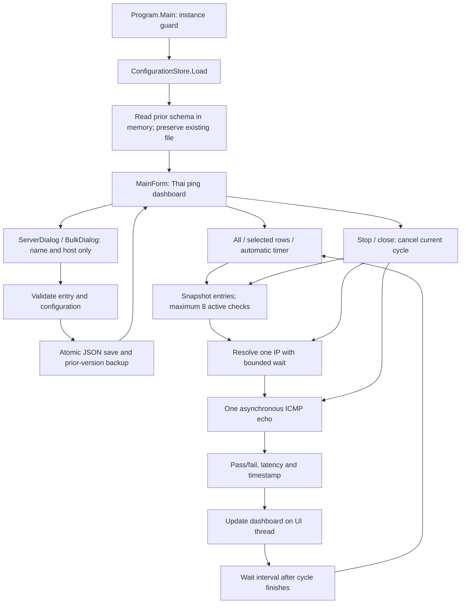
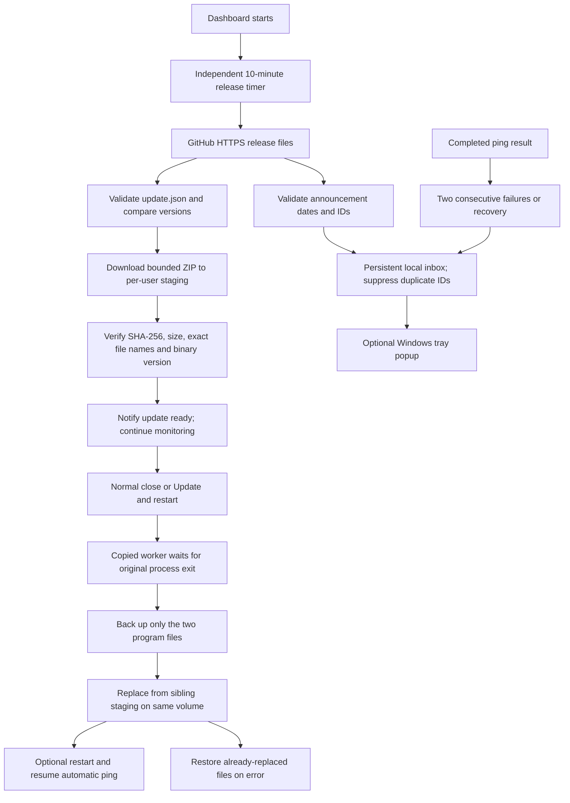

# Code review, data flow and function index

## Initial inspection and scope

The requested workspace was empty on 2026-10-09 and was not inside a Git repository. There was no existing application code, database, configuration, or packaging to refactor. This delivery creates an isolated Windows Forms application. It does not change other projects, install services, edit firewalls, or invoke command-line ping. Reachability checking still uses DNS and ICMP echo only. Version 1.2 adds separate HTTPS connections to a public GitHub release channel for program updates and announcements. Port/method configuration, TCP connections, partial-pass status and report export were removed at the user's request.

The app uses C# and the Windows .NET Framework 4.8 libraries. No package manager or third-party runtime dependencies are introduced. The source tree contains complete readable source; no generated/minified implementation is tracked.

## Data flow

### Startup and persistence

`Program.Main` initializes Windows Forms and takes a session-local, per-user mutex. A second instance in the same Windows session displays a Thai message. `MainForm` loads the per-user JSON file through an injected `ConfigurationStore`; a first launch returns default settings without creating a data file.

Both loading and saving validate schema version, names, hosts, IDs and settings ranges. Loading a version-1 file promotes its schema to version 2 in memory; the serializer ignores the obsolete port/method fields. It preserves every entry, including duplicate hosts, and does not rewrite the original file. The next normal save backs up the previous file and writes only the current fields. A failed load stops startup and reports the existing file location. A save writes a unique temporary file in the same data directory, flushes it, then renames/replaces it atomically. Replacement retains the previous file as `.bak`. `MainForm.CommitConfiguration` updates its in-memory configuration only after persistence succeeds. Server edits invalidate their old check result; deletion removes matching result records.

The mutex is session-local: do not edit one user's settings concurrently from multiple Windows sessions or external tools. Server lists have no cross-machine synchronization or shared central database. Public release and announcement feeds are separate from server-list storage.

### Check scheduling and threading

`MainForm.RunChecksAsync` snapshots the chosen entries and timeout, stops the timer, and disables mutation controls. A semaphore permits at most eight active server entries. DNS gets its own timeout; a successful resolution selects the first IPv4 address or first available address. One ICMP echo request is sent to the selected IP per entry per cycle. A successful echo reply produces a passed result; DNS errors, timeout and other unsuccessful replies produce a failed result. DNS and echo waits have separate timeout budgets.

`NetworkProbe` uses `ConfigureAwait(false)` internally. `MainForm` awaits the probe on the Windows Forms synchronization context, so grid, counter, and dictionary updates occur on the UI thread. Search can safely rebuild visible rows while a check is running: completed results are stored by stable entry ID and applied only to currently visible matching rows.

`WithinAsync` races the operation against a linked cancellable delay. Ping resources are disposed after completion, timeout or cancellation. Late DNS/ping faults are explicitly observed; Framework DNS itself cannot be forcibly cancelled, so a timed-out DNS operation may finish in the background. Its result is discarded and never applied after cancellation.

Cancellation preserves completed results and previous results for unfinished entries. Closing marks the window as closing before cancelling; subsequent continuations skip UI work. The next automatic cycle starts only after all tasks in the current cycle settle and the configured delay elapses. Turning off automatic mode stops future cycles; the Stop button also cancels the current cycle.

### Dashboard result meaning

The results dictionary is memory-only and keyed by entry ID. Rows display the latest completed ping status, response duration and completion timestamp. Untested entries have an explicit status. A missing ping result cannot be classified as passed. There is no partial-pass state, report writer, export workflow or historical result storage.

Results describe ICMP echo reachability. A firewall dropping echo packets can produce a failed check. Multiple hostname DNS records are not exhaustively checked. The actual chosen IP and detailed ping response appear in row detail/tooltip.

## Update and notification data flow (1.2)

The official public source and release repository is compiled as `kumatech112/Server_Bot_Tracker`, following the owner's visibility change. Public URLs are fixed to stable release assets, not arbitrary commands or publisher-supplied executable URLs. HTTPS redirects are limited to GitHub's known release hosts, with a five-redirect limit, a 45-second whole-transfer cancellation deadline and byte limits. Cancellation disposes an active response body so stalled streams cannot hold the check open. Missing releases and invalid responses never count as an up-to-date result.

`PrepareAsync` rejects the current/older version, downloads into a unique user-data directory, verifies a manifest hash and size, and validates an exact two-file ZIP before inspecting the PE version/product name. ZIP paths are an allowlist, preventing nested paths, traversal, extra entries and duplicate names. Payloads must match the declared version. DataContract JSON accepts UTF-8 with or without a BOM so the Windows PowerShell publisher interoperates correctly.

A worker copy runs from staging before the main process closes. It uses a job with parent process ID/start time and waits up to 60 seconds for exit; it does not kill a process. It independently revalidates the package before installation. Replacement files are copied beside the target first so `File.Replace` stays on one volume, including when the portable target is a network share. Backups live in the user's update staging directory. If a later replacement fails, each already-changed program file is restored. Only the EXE and runtime config are replaced; server data and unrelated files are untouched. Results are recorded as `updates/<id>/result.json`. Optional Windows uninstall-version metadata is updated only when its install path matches the target.

A normal close applies a prepared update only when automatic updates remain enabled. The explicit restart action may also install it. Windows shutdown and Task Manager closure skip worker launch. Restart resumes automatic monitoring only if it was active before the update. Closing also cancels HTTP polling. There is no forced mid-session restart and no repeated network request while another release check is active.

Notification state is independent of `servers.json`: automatic-update preference, local-alert preference, last 100 messages, read state, and up to 1,000 seen IDs are persisted in `notifications.json`. A corrupt inbox is preserved read-only while the app uses memory-only state. Each server's alert baseline is session-local: two consecutive failed completed checks trigger down once, a later successful check triggers recovery once, and edits/deletions clear the baseline. Turning alert preferences on/off resets baselines. Announcement IDs suppress repeat notices across launches; published/expiry times are checked in UTC. Text is plain text, with no HTML, embedded actions or remote code execution. All mutations occur on the UI thread.

The installer is a native per-user Windows Forms setup compiled from `tools/setup/Setup.cs`, `SetupForm.cs`, `InstallLocation.cs` and `DesktopShortcut.cs`. It embeds the same two-file ZIP, installs into the selected writable folder (default LocalAppData/Programs), creates one Start menu shortcut and one HKCU uninstall registration. It takes the same per-user instance mutex and asks users to close the dashboard first. Uninstall removes only known files and the matching shortcut/product registry key; user settings remain. Setup has no third-party build-tool dependency.

## Product branding and classic wizard flow (1.4)

The owner supplied `server-tracker.ico` and a 512-pixel PNG. Unmodified copies live under `assets/branding`; both are embedded into both EXEs. The ICO is also passed to the compiler as `/win32icon`. `Branding` loads resources from its own assembly, allowing the same readable source to compile into the app and setup. The app sets its window/taskbar icon, adds a header logo, assigns the tray icon, and gives dialogs the product icon through `Theme.ApplyDialog`. Owned icon/image instances are disposed with their window or control. Start menu shortcuts explicitly use the application EXE's icon, and the uninstall copy inherits the setup icon. The portable ZIP remains exactly two files.

The dashboard retains its existing light/blue palette. Setup uses the owner's OBS-style reference: a navy artwork panel, white pages and native navigation buttons. Installation states are welcome -> destination -> confirmation -> working -> complete; uninstall skips destination. Failure allows retry or Back to the appropriate review page. Next only validates/advances and performs no file operation. Operation execution uses a dedicated STA worker and prevents close/reentry while files change. Launch is offered only after installation, never after removal. No OBS artwork or implementation was copied.

Control Panel registration includes the quoted uninstall command, version, publisher, icon, NoModify/NoRepair, installation date and estimated size. Its `--uninstall` entry copies the EXE to Temp and launches `--uninstall-wizard` with the launcher's PID, start time and normalized original EXE directory. The helper waits for that specific launcher to exit before showing the wizard, so the installed Uninstall.exe can later be deleted. No files are removed until confirmation. `RemoveInstallation` owns the product mutex, refuses volume/share roots, deletes only three known files, and deletes the product directory only if empty. The shortcut and registry key are removed only if InstallLocation still matches that target. Its mutex is released on both success and failure. User data and unrelated files/directories remain. Tests invoke the same private engines with isolated file and registry paths.

### Selected installation folder (1.5)

Setup reads the previous HKCU InstallLocation through `InstallLocation.ReadRemembered`, falling back to the original per-user default for absent/invalid values. The destination page accepts typed absolute drive/UNC subfolder paths or the exact FolderBrowserDialog selection. `Normalize` rejects blank, relative, device, root and invalid paths. `ValidateProductFiles` prevents overwriting unrelated EXEs/uninstallers or an orphaned runtime config with a colliding name. Advancing to confirmation does not probe writes or create directories.

Confirmation freezes the normalized folder passed to `Action<string>`. `Install` delegates to `InstallAt`, which takes the product mutex, revalidates ownership, creates same-folder staging, backs up all three owned files, extracts the exact two-file payload, copies the uninstaller, and creates the shortcut/Control Panel entry using the same target. Staging cleanup and mutex release also run after directory creation errors. Completion launches the selected EXE with its folder as WorkingDirectory. Choosing a different folder leaves the previous copy in place and redirects the single product registration; no recursive move/delete is performed. Version 1.5 uninstallers preserve registration belonging to another folder; legacy uninstallers retain their older behavior.

The updater already takes the running application's actual base directory and uses same-volume replacement; no updater implementation change is required. User settings stay at the original LocalAppData data path. Setup runs as the current user and requires a writable destination; it does not automatically elevate for protected folders. The portable archive remains exactly two files, preserving compatibility with the original 1.2 updater.

`DesktopShortcut.Create` uses native Unicode `IShellLinkW` and `IPersistFile`, with explicit path, working directory, description and icon and guaranteed COM release. This replaces the WScript.Shell dynamic shortcut call after the English Windows CI runner rejected shortcut creation during real custom-folder installation. The verification runner compiles the same interop declarations, then independently loads the saved .lnk through IPersistFile and reads its target, working directory and icon. Thai paths are retained without depending on the machine's legacy script-host code page.

The app updater still validates and replaces exactly two program files. It does not replace Uninstall.exe, so upgrading the installer UI requires running the new Setup once. Optional Control Panel version updates now compare normalized install paths, allowing trailing directory separators without matching a different installation. Ping behavior, settings schema and the dashboard layout are unchanged.

`tools/Package.ps1` creates the ZIP, matching manifest and setup under the ignored release tree. `Prepare-Announcement.ps1` prepares text locally and sends nothing. The GitHub workflow builds and verifies the package, then publishes three assets in the same public repository when a matching version tag is pushed. A manual run creates a draft. It uses GitHub's built-in workflow token with Contents write permission; clients receive no credential. The workflow initializes an empty announcement feed if needed. Compiler input is explicitly UTF-8 to preserve Thai on English Windows runners. Windows Authenticode signing is optional owner infrastructure via `tools/Sign.ps1`; HTTPS/SHA-256 validation is not a Windows publisher certificate.

## Function index

All current application functions are listed below. Methods with the same name belong to the explicitly identified class. Core dashboard behavior remains in `MainForm.cs`; update/notification UI is isolated in the partial class `MainForm.Notifications.cs`.

| File / class | Function | Responsibility |
| --- | --- | --- |
| `src/Program.cs` / Program | `Main` | Route update-worker mode, initialize GUI, guard duplicate launch and resume monitoring after an update |
| `src/Models.cs` / ServerEntry | constructor | Initialize stable ID and entry defaults |
| `src/Models.cs` / ServerEntry | `Copy` | Create independent editable / check snapshot |
| `src/Models.cs` / ServerEntry | `Validate` | Validate name and host |
| `src/Models.cs` / AppConfiguration | constructor | Initialize schema, empty list and settings defaults |
| `src/Models.cs` / AppConfiguration | `Copy` | Deep-copy entries before mutation |
| `src/Models.cs` / AppConfiguration | `Validate` | Validate schema/settings/entries and reject duplicate IDs |
| `src/Models.cs` / ServerResult | `Summary` getter | Compute ping pass/fail or untested status |
| `src/ConfigurationStore.cs` / ConfigurationStore | constructor | Normalize an explicit storage file path |
| `src/ConfigurationStore.cs` / ConfigurationStore | `ForCurrentUser` | Resolve the per-user LocalAppData data path |
| `src/ConfigurationStore.cs` / ConfigurationStore | `Load` | Read validated data, adapt schema 1 in memory and preserve unreadable files |
| `src/ConfigurationStore.cs` / ConfigurationStore | `Save` | Validate and atomically persist with backup and temporary-file cleanup |
| `src/NetworkProbe.cs` / NetworkProbe | `CheckAsync` | Resolve address, send ping, assemble completed result |
| `src/NetworkProbe.cs` / NetworkProbe | `CheckPingAsync` | ICMP echo, latency and timeout/error translation |
| `src/NetworkProbe.cs` / NetworkProbe | `Failure` | Create a failed result with an explicit message |
| `src/NetworkProbe.cs` / NetworkProbe | `WithinAsync` | Bound waits, prioritize cancellation, and observe abandoned faults |
| `src/NetworkProbe.cs` / NetworkProbe | `ObserveFailure` | Consume a late task exception without UI side effects |
| `src/Theme.cs` / Theme | `Button` | Consistent button colors, dimensions and padding |
| `src/Theme.cs` / Theme | `Label` | Consistent label styling |
| `src/Theme.cs` / Theme | `ApplyDialog` | Apply product icon, Thai font, DPI behavior and modal window styling |
| `src/ServerDialog.cs` / ServerDialog | constructor | Build/populate single-entry editor |
| `src/ServerDialog.cs` / ServerDialog | `SaveEntry` | Validate editor input and return an independent entry |
| `src/ServerDialog.cs` / BulkDialog | constructor | Build multiline entry dialog |
| `src/ServerDialog.cs` / BulkDialog | `AddEntries` | Parse one host per line, validate all and deduplicate lines |
| `src/MainForm.cs` / MainForm | constructor | Load data, initialize window and attach lifecycle/timer handlers |
| `src/MainForm.cs` / MainForm | `BuildLayout` | Arrange branded heading, totals, tools, grid and status |
| `src/MainForm.cs` / MainForm | `BuildToolbar` | Bind CRUD, checking and Stop actions |
| `src/MainForm.cs` / MainForm | `AddEditButton` | Register buttons disabled during checks |
| `src/MainForm.cs` / MainForm | `BuildSettings` | Wire filter, timeout, interval and automatic checking |
| `src/MainForm.cs` / MainForm | `BuildGrid` | Define result table styling and interactions |
| `src/MainForm.cs` / MainForm | `AddColumn` | Define a named sortable read-only result column |
| `src/MainForm.cs` / MainForm | `RenderRows` | Filter/rebuild visible rows, restore selection and apply saved results |
| `src/MainForm.cs` / MainForm | `SelectedIds` | Map row selection to stable entry IDs |
| `src/MainForm.cs` / MainForm | `UpdateRow` | Render ping status, latency, color, timestamp and tooltip |
| `src/MainForm.cs` / MainForm | `ProbeText` | Format probe message and optional duration |
| `src/MainForm.cs` / MainForm | `UpdateTotals` | Count latest completed status and visible/untested entries |
| `src/MainForm.cs` / MainForm | `ShowSelectedDetails` | Display resolved IP and complete ping message |
| `src/MainForm.cs` / MainForm | `RunChecksAsync` | Snapshot, schedule, cancel, collect and complete one bounded check cycle |
| `src/MainForm.cs` / MainForm | `SetBusy` | Toggle checking and mutation controls |
| `src/MainForm.cs` / MainForm | `CommitConfiguration` | Persist before changing in-memory configuration |
| `src/MainForm.cs` / MainForm | `AddServer` | Add a validated entry through the editor |
| `src/MainForm.cs` / MainForm | `AddMany` | Add validated bulk entries and skip existing hosts |
| `src/MainForm.cs` / MainForm | `EditServer` | Replace one selected entry and invalidate its old result |
| `src/MainForm.cs` / MainForm | `DeleteServers` | Confirm and persist deletion of selected entries |
| `src/MainForm.cs` / MainForm | `SaveSettings` | Persist interval/timeout, revert controls on failure and reschedule timer |
| `src/MainForm.cs` / MainForm | `OnClosing` | Stop scheduling, cancel current cycle and suppress later UI updates |

`src/AssemblyInfo.cs` supplies version and Framework metadata; `src/app.manifest` declares user-level execution and DPI awareness. `tools/ServerBotTracker.exe.config` is the tracked source for the release runtime config.

### Added update, notification and installer functions

| File / class | Function | Responsibility |
| --- | --- | --- |
| `src/MainForm.Notifications.cs / MainForm` | `InitializeNotifications` | Load independent inbox state, wire timer, tray, lifecycle and preferences |
| `src/MainForm.Notifications.cs / MainForm` | `BuildNotificationButtons` | Add notification and update actions to the heading |
| `src/MainForm.Notifications.cs / MainForm` | `RefreshNotificationCount` | Display unread count |
| `src/MainForm.Notifications.cs / MainForm` | `ResumeMonitoring` | Resume automatic checks after updater-requested restart |
| `src/MainForm.Notifications.cs / MainForm` | `AddNotification` | Persist/de-duplicate notice and optionally display tray balloon |
| `src/MainForm.Notifications.cs / MainForm` | `PublishServerAlert` | Translate confirmed ping transitions into local notices |
| `src/MainForm.Notifications.cs / MainForm` | `CheckReleaseAsync` | Poll update and announcement feeds without overlapping checks |
| `src/MainForm.Notifications.cs / MainForm` | `ShowNotifications` | Present inbox, read-all action and local alert preference |
| `src/MainForm.Notifications.cs / MainForm` | `ShowUpdateDetails` | Present version, notes, automatic-update preference and restart action |
| `src/MainForm.Notifications.cs / MainForm` | `ScheduleUpdateOnExit` | Cancel polling and launch a prepared worker when allowed |
| `src/Notifications.cs / NotificationState` | `constructor` | Initialize preferences and empty notification lists |
| `src/Notifications.cs / NotificationCenter` | `constructor` | Load independent local state or preserve unreadable data |
| `src/Notifications.cs / NotificationCenter` | `Add` | Bound history, suppress duplicate IDs and save |
| `src/Notifications.cs / NotificationCenter` | `MarkAllRead` | Persist read state |
| `src/Notifications.cs / NotificationCenter` | `Save` | Persist atomically and raise UI change event |
| `src/Notifications.cs / ServerAlertTracker` | `Observe` | Track independent consecutive failures and recovery |
| `src/Notifications.cs / ServerAlertTracker` | `Forget` | Reset state for an edited/deleted server or preference change |
| `src/Notifications.cs / JsonData` | `Read` | Read size-bounded local JSON |
| `src/Notifications.cs / JsonData` | `Deserialize` | Read seekable UTF-8 JSON with optional BOM |
| `src/Notifications.cs / JsonData` | `WriteAtomic` | Flush temporary JSON, replace and retain backup |
| `src/ReleaseChannel.cs / ReleaseManifest` | `Validate` | Check schema, version/tag, digest, size and notes |
| `src/ReleaseChannel.cs / AnnouncementFeed` | `Validate` | Check item bounds, unique IDs, text and date ranges |
| `src/ReleaseChannel.cs / Announcement` | `PublishedTime getter` | Normalize the publish timestamp to UTC |
| `src/ReleaseChannel.cs / Announcement` | `ExpiresTime getter` | Normalize the expiry timestamp to UTC |
| `src/ReleaseChannel.cs / Announcement` | `ParseUtc` | Validate ISO-compatible timestamp data |
| `src/ReleaseChannel.cs / Announcement` | `IsActive` | Apply publish/expiry window |
| `src/ReleaseChannel.cs / ReleaseChannel` | `ReleaseChannel()` | Bind the official repository and native HTTP handler |
| `src/ReleaseChannel.cs / ReleaseChannel` | `ReleaseChannel(string, HttpMessageHandler)` | Bind an isolated channel/handler for verification without credentials |
| `src/ReleaseChannel.cs / ReleaseChannel` | `CurrentVersion getter` | Read the application's assembly version |
| `src/ReleaseChannel.cs / ReleaseChannel` | `ParseVersion` | Normalize three/four-part versions for comparisons |
| `src/ReleaseChannel.cs / ReleaseChannel` | `GetLatestAsync` | Read and validate stable update manifest |
| `src/ReleaseChannel.cs / ReleaseChannel` | `GetAnnouncementsAsync` | Read and validate independent announcement feed |
| `src/ReleaseChannel.cs / ReleaseChannel` | `ReadJsonAsync` | Download bounded JSON and deserialize |
| `src/ReleaseChannel.cs / ReleaseChannel` | `PrepareAsync` | Download and validate a newer package in local staging |
| `src/ReleaseChannel.cs / ReleaseChannel` | `DownloadAsync` | Enforce HTTPS hosts, redirects, timeout and byte limits |
| `src/ReleaseChannel.cs / ReleaseChannel` | `VerifyPackage` | Check SHA-256 and exact byte size |
| `src/ReleaseChannel.cs / ReleaseChannel` | `ExtractPackage` | Allowlist payload paths and check executable identity/version |
| `src/ReleaseChannel.cs / ReleaseChannel` | `Dispose` | Release HTTP resources |
| `src/UpdateInstaller.cs / UpdateInstaller` | `LaunchWorker` | Copy worker and persist explicit installation job |
| `src/UpdateInstaller.cs / UpdateInstaller` | `RunWorker` | Wait for parent, apply update, record result and optionally restart |
| `src/UpdateInstaller.cs / UpdateInstaller` | `Apply` | Revalidate, back up, replace, rollback and update matching Windows version metadata |
| `tools/setup/Setup.cs / Setup` | `Target getter` | Read the remembered installation folder or per-user default |
| `tools/setup/Setup.cs / Setup` | `Shortcut getter` | Resolve the product Start menu shortcut |
| `tools/setup/Setup.cs / Setup` | `Main` | Route Thai setup UI, silent install and uninstall helper |
| `tools/setup/Setup.cs / Setup` | `AcquireInstance` | Coordinate with the dashboard's per-user mutex |
| `tools/setup/Setup.cs / Setup` | `Install` | Bind the selected target to the product shortcut and registry paths |
| `tools/setup/Setup.cs / Setup` | `InstallAt` | Validate and install payload, uninstaller, shortcut and registry metadata at an explicit target |
| `tools/setup/Setup.cs / Setup` | `Remove` | Remove only known installed files and product registration |

### Branding and guided installer functions

| File / class | Function | Responsibility |
| --- | --- | --- |
| `src/Branding.cs / Branding` | `CreateIcon` | Load and clone the embedded multi-size ICO without retaining a resource stream |
| `src/Branding.cs / Branding` | `ApplyTo` | Apply the product icon to a form and dispose it with the form |
| `src/Branding.cs / Branding` | `CreateLogoBox` | Create a zoomed embedded PNG control and dispose its image with the control |
| `src/MainForm.cs / MainForm` | `MainForm(ConfigurationStore, bool)` | Apply the app icon before building the unchanged dashboard workflow |
| `src/MainForm.Notifications.cs / MainForm` | `InitializeNotifications` | Assign the product tray icon and dispose it when monitoring closes |
| `tools/setup/SetupForm.cs / SetupForm` | constructor | Apply product styling and bind installation, close and keyboard actions |
| `tools/setup/SetupForm.cs / SetupForm` | `BuildLayout` | Compose branded welcome, destination, progress, completion and action areas |
| `tools/setup/SetupForm.cs / SetupForm` | `RunPrimaryAction` | Handle installation, visible failure/retry, completion and optional app launch |
| `tools/setup/SetupForm.cs / SetupForm` | `RunOperationAsync` | Run install or removal on one STA worker and propagate its result |
| `tools/setup/SetupForm.cs / SetupForm` | `PreventCloseDuringOperation` | Prevent user closure while installing or removing files |
| `tools/setup/Setup.cs / Setup` | `Main` | Route interactive setup through the separated SetupForm while preserving silent/uninstall routes |
| `tools/setup/InstallLocation.cs / InstallLocation` | `DefaultDirectory getter` | Resolve the original first-install per-user location |
| `tools/setup/InstallLocation.cs / InstallLocation` | `Normalize` | Validate absolute paths, reject roots/invalid segments and remove trailing separators |
| `tools/setup/InstallLocation.cs / InstallLocation` | `ReadRemembered` | Read the registered folder with a safe default for absent/invalid/inaccessible metadata |
| `tools/setup/InstallLocation.cs / InstallLocation` | `Matches` | Compare normalized folders for registration ownership |
| `tools/setup/InstallLocation.cs / InstallLocation` | `ValidateProductFiles` | Reject unrelated files with product-owned names before writes |
| `tools/setup/DesktopShortcut.cs / DesktopShortcut` | `Create` | Save a native Unicode Windows shortcut and always release its COM object |
| `tools/setup/DesktopShortcut.cs / IShellLinkW` | COM interface methods | Declare the complete native vtable for Unicode shortcut creation and verification |
| `tools/setup/SetupForm.cs / SetupForm` | `GoBack` | Return to editable destination or welcome while preserving the path |
| `tools/setup/SetupForm.cs / SetupForm` | `BrowseDirectory` | Open the native folder chooser and retain the exact selected folder |
| `tools/setup/SetupForm.cs / SetupForm` | `ShowPage` | Render state-specific text, navigation, progress, confirmation and completion |
| `tools/setup/SetupForm.cs / WizardArtwork` | constructor / `OnPaint` | Draw the classic blue geometric artwork panel behind the supplied robot |
| `tools/setup/Setup.cs / Setup` | `StartUninstallWizard` | Copy and launch the temporary UI helper with launcher identity and original installation folder |
| `tools/setup/Setup.cs / Setup` | `WaitForLauncher` | Bound the wait for the exact original uninstaller process to exit |
| `tools/setup/Setup.cs / Setup` | `RemoveInstallation` | Guard and remove only an explicit installation, shortcut and registration; preserve other content |
| `src/UpdateInstaller.cs / UpdateInstaller` | `MatchesInstallLocation` | Match equivalent full install paths for optional Control Panel version metadata |

## Build and verification boundaries

`tools/Build.ps1` stages the complete C# source, branding and manifest in a unique local development directory, compiles with warnings as errors, copies the two runtime files to `release`, prints the hash, and removes only its verified staging directory. `Package.ps1` embeds the same assets and shared Branding/Theme source into Setup. Neither command performs network package restore.

`tools/Verify.ps1` compiles a separate verification runner outside the project. `tools/checks/Verification.cs` groups maintained checks in `VerifyPersistence`, `VerifyValidation`, `VerifyLegacyConfiguration`, `VerifyDeadline`, `VerifyNetworkAndGui`, `VerifyNotificationDialogs`, `VerifyServerDialogs`, and `VerifyLaunch`. `UpdatesVerification.cs` adds isolated feed/HTTP, notification, archive, rollback and real worker-process checks. Helper functions provide assertions, control discovery and bounded message pumping. The runner uses isolated fixture settings; it does not change the user's server list. It retains evidence outside the project and compares tested/released binary hashes.

The source is reviewed before building and the resulting GUI/executable is checked after building. The revised checks verify legacy-list compatibility and the removal of unnecessary dashboard/editor controls. Verification details and practical limits are recorded in `VERIFICATION.md`.

`tools/checks/SetupVerification.cs` verifies original embedded assets, Windows file icons, and welcome/destination/confirmation/progress/completion/close-blocking/retry under real message loops. Its UI callback records the selected path without installing. `VerifyCustomInstallation` separately invokes the real install engine in isolated Thai paths with spaces, checks real COM shortcut/HKCU metadata, applies an actual update, then removes old/new fixture installations and checks ownership/data preservation. `VerifyUninstall` covers failure/retry with a locked fixture. `Run`, `VerifyBranding`, `Hash`, `SameImage`, `RenderIcon`, `CreateForm`, `VerifyInstallFlow`, `VerifyRetry`, `WaitUntilEnabled` and `Capture` keep checks separate from product code. The verification executable declares .NET Framework 4.8 and uses the application's runtime config. Both tested EXEs are checked against their release hashes.

## API references

- [Microsoft: Ping](https://learn.microsoft.com/en-us/dotnet/api/system.net.networkinformation.ping?view=netframework-4.8)
- [Microsoft: Unicode IShellLinkW](https://learn.microsoft.com/en-us/windows/win32/api/shobjidl_core/nn-shobjidl_core-ishelllinkw)
