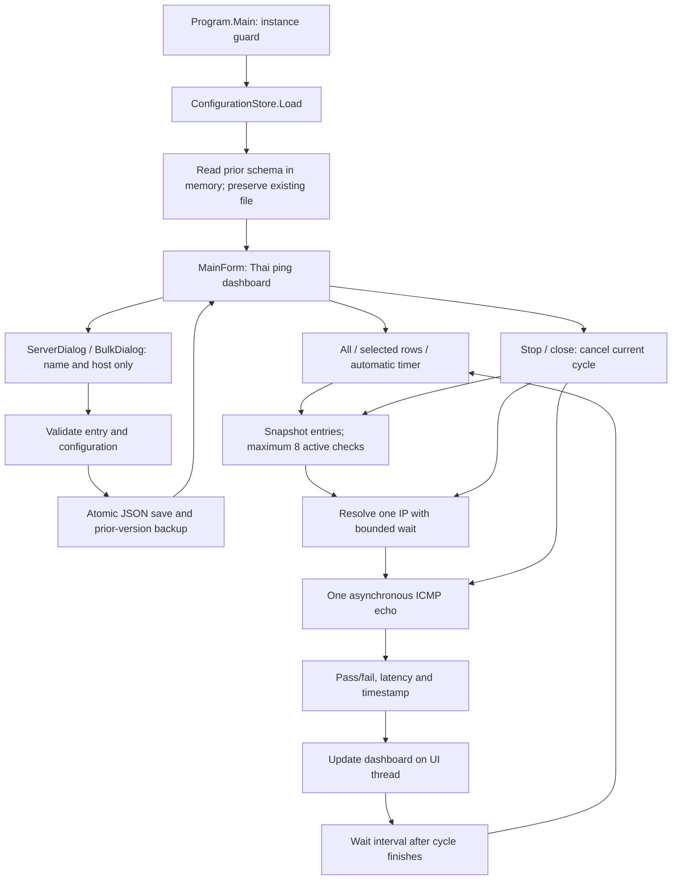

# Code review, data flow and function index

## Initial inspection and scope

The requested workspace was empty on 2026-10-09 and was not inside a Git repository. There was no existing application code, database, configuration, or packaging to refactor. This delivery creates an isolated Windows Forms application. It does not change other projects, install services, edit firewalls, or invoke command-line ping. Version 1.1 sends DNS lookups and ICMP echo requests only. Port/method configuration, TCP connections, partial-pass status and report export were removed at the user's request.

The app uses C# and the Windows .NET Framework 4.8 libraries. No package manager or third-party runtime dependencies are introduced. The source tree contains complete readable source; no generated/minified implementation is tracked.

## Data flow

### Startup and persistence

`Program.Main` initializes Windows Forms and takes a session-local, per-user mutex. A second instance in the same Windows session displays a Thai message. `MainForm` loads the per-user JSON file through an injected `ConfigurationStore`; a first launch returns default settings without creating a data file.

Both loading and saving validate schema version, names, hosts, IDs and settings ranges. Loading a version-1 file promotes its schema to version 2 in memory; the serializer ignores the obsolete port/method fields. It preserves every entry, including duplicate hosts, and does not rewrite the original file. The next normal save backs up the previous file and writes only the current fields. A failed load stops startup and reports the existing file location. A save writes a unique temporary file in the same data directory, flushes it, then renames/replaces it atomically. Replacement retains the previous file as `.bak`. `MainForm.CommitConfiguration` updates its in-memory configuration only after persistence succeeds. Server edits invalidate their old check result; deletion removes matching result records.

The mutex is session-local: do not edit one user's settings concurrently from multiple Windows sessions or external tools. The application has no cross-machine synchronization or shared central database.

### Check scheduling and threading

`MainForm.RunChecksAsync` snapshots the chosen entries and timeout, stops the timer, and disables mutation controls. A semaphore permits at most eight active server entries. DNS gets its own timeout; a successful resolution selects the first IPv4 address or first available address. One ICMP echo request is sent to the selected IP per entry per cycle. A successful echo reply produces a passed result; DNS errors, timeout and other unsuccessful replies produce a failed result. DNS and echo waits have separate timeout budgets.

`NetworkProbe` uses `ConfigureAwait(false)` internally. `MainForm` awaits the probe on the Windows Forms synchronization context, so grid, counter, and dictionary updates occur on the UI thread. Search can safely rebuild visible rows while a check is running: completed results are stored by stable entry ID and applied only to currently visible matching rows.

`WithinAsync` races the operation against a linked cancellable delay. Ping resources are disposed after completion, timeout or cancellation. Late DNS/ping faults are explicitly observed; Framework DNS itself cannot be forcibly cancelled, so a timed-out DNS operation may finish in the background. Its result is discarded and never applied after cancellation.

Cancellation preserves completed results and previous results for unfinished entries. Closing marks the window as closing before cancelling; subsequent continuations skip UI work. The next automatic cycle starts only after all tasks in the current cycle settle and the configured delay elapses. Turning off automatic mode stops future cycles; the Stop button also cancels the current cycle.

### Dashboard result meaning

The results dictionary is memory-only and keyed by entry ID. Rows display the latest completed ping status, response duration and completion timestamp. Untested entries have an explicit status. A missing ping result cannot be classified as passed. There is no partial-pass state, report writer, export workflow or historical result storage.

Results describe ICMP echo reachability. A firewall dropping echo packets can produce a failed check. Multiple hostname DNS records are not exhaustively checked. The actual chosen IP and detailed ping response appear in row detail/tooltip.

## Function index

All current application functions are listed below. Methods with the same name belong to the explicitly identified class. UI construction and behavior are grouped in `MainForm` so a small app does not require dozens of single-purpose files.

| File / class | Function | Responsibility |
| --- | --- | --- |
| `src/Program.cs` / Program | `Main` | Initialize GUI, guard same-session duplicate launch, load user store, report startup errors |
| `src/Models.cs` / ServerEntry | constructor | Initialize stable ID and entry defaults |
| `src/Models.cs` / ServerEntry | `Copy` | Create independent editable / check snapshot |
| `src/Models.cs` / ServerEntry | `Validate` | Validate name and host |
| `src/Models.cs` / AppConfiguration | constructor | Initialize schema, empty list and settings defaults |
| `src/Models.cs` / AppConfiguration | `Copy` | Deep-copy entries before mutation |
| `src/Models.cs` / AppConfiguration | `Validate` | Validate schema/settings/entries and reject duplicate IDs |
| `src/Models.cs` / ServerResult | `Summary` getter | Compute ping pass/fail or untested status |
| `src/ConfigurationStore.cs` / ConfigurationStore | constructor | Normalize an explicit storage file path |
| `src/ConfigurationStore.cs` / ConfigurationStore | `ForCurrentUser` | Resolve the per-user LocalAppData data path |
| `src/ConfigurationStore.cs` / ConfigurationStore | `Load` | Read validated data, adapt schema 1 in memory and preserve unreadable files |
| `src/ConfigurationStore.cs` / ConfigurationStore | `Save` | Validate and atomically persist with backup and temporary-file cleanup |
| `src/NetworkProbe.cs` / NetworkProbe | `CheckAsync` | Resolve address, send ping, assemble completed result |
| `src/NetworkProbe.cs` / NetworkProbe | `CheckPingAsync` | ICMP echo, latency and timeout/error translation |
| `src/NetworkProbe.cs` / NetworkProbe | `Failure` | Create a failed result with an explicit message |
| `src/NetworkProbe.cs` / NetworkProbe | `WithinAsync` | Bound waits, prioritize cancellation, and observe abandoned faults |
| `src/NetworkProbe.cs` / NetworkProbe | `ObserveFailure` | Consume a late task exception without UI side effects |
| `src/Theme.cs` / Theme | `Button` | Consistent button colors, dimensions and padding |
| `src/Theme.cs` / Theme | `Label` | Consistent label styling |
| `src/Theme.cs` / Theme | `ApplyDialog` | Apply Thai font, DPI behavior and modal window styling |
| `src/ServerDialog.cs` / ServerDialog | constructor | Build/populate single-entry editor |
| `src/ServerDialog.cs` / ServerDialog | `SaveEntry` | Validate editor input and return an independent entry |
| `src/ServerDialog.cs` / BulkDialog | constructor | Build multiline entry dialog |
| `src/ServerDialog.cs` / BulkDialog | `AddEntries` | Parse one host per line, validate all and deduplicate lines |
| `src/MainForm.cs` / MainForm | constructor | Load data, initialize window and attach lifecycle/timer handlers |
| `src/MainForm.cs` / MainForm | `BuildLayout` | Arrange heading, totals, tools, grid and status |
| `src/MainForm.cs` / MainForm | `BuildToolbar` | Bind CRUD, checking and Stop actions |
| `src/MainForm.cs` / MainForm | `AddEditButton` | Register buttons disabled during checks |
| `src/MainForm.cs` / MainForm | `BuildSettings` | Wire filter, timeout, interval and automatic checking |
| `src/MainForm.cs` / MainForm | `BuildGrid` | Define result table styling and interactions |
| `src/MainForm.cs` / MainForm | `AddColumn` | Define a named sortable read-only result column |
| `src/MainForm.cs` / MainForm | `RenderRows` | Filter/rebuild visible rows, restore selection and apply saved results |
| `src/MainForm.cs` / MainForm | `SelectedIds` | Map row selection to stable entry IDs |
| `src/MainForm.cs` / MainForm | `UpdateRow` | Render ping status, latency, color, timestamp and tooltip |
| `src/MainForm.cs` / MainForm | `ProbeText` | Format probe message and optional duration |
| `src/MainForm.cs` / MainForm | `UpdateTotals` | Count latest completed status and visible/untested entries |
| `src/MainForm.cs` / MainForm | `ShowSelectedDetails` | Display resolved IP and complete ping message |
| `src/MainForm.cs` / MainForm | `RunChecksAsync` | Snapshot, schedule, cancel, collect and complete one bounded check cycle |
| `src/MainForm.cs` / MainForm | `SetBusy` | Toggle checking and mutation controls |
| `src/MainForm.cs` / MainForm | `CommitConfiguration` | Persist before changing in-memory configuration |
| `src/MainForm.cs` / MainForm | `AddServer` | Add a validated entry through the editor |
| `src/MainForm.cs` / MainForm | `AddMany` | Add validated bulk entries and skip existing hosts |
| `src/MainForm.cs` / MainForm | `EditServer` | Replace one selected entry and invalidate its old result |
| `src/MainForm.cs` / MainForm | `DeleteServers` | Confirm and persist deletion of selected entries |
| `src/MainForm.cs` / MainForm | `SaveSettings` | Persist interval/timeout, revert controls on failure and reschedule timer |
| `src/MainForm.cs` / MainForm | `OnClosing` | Stop scheduling, cancel current cycle and suppress later UI updates |

`src/AssemblyInfo.cs` supplies version and Framework metadata; `src/app.manifest` declares user-level execution and DPI awareness. `tools/ServerBotTracker.exe.config` is the tracked source for the release runtime config.

## Build and verification boundaries

`tools/Build.ps1` stages the complete C# source and manifest in a unique local development directory, compiles with warnings as errors, copies the two runtime files to `release`, prints the hash, and removes only its verified staging directory. It performs no network package restore.

`tools/Verify.ps1` compiles a separate verification runner outside the project. `tools/checks/Verification.cs` groups maintained checks in `VerifyPersistence`, `VerifyValidation`, `VerifyLegacyConfiguration`, `VerifyDeadline`, `VerifyNetworkAndGui`, `VerifyServerDialogs`, and `VerifyLaunch`. Helper functions provide assertions, control discovery and bounded message pumping. The runner uses isolated fixture settings; it does not change the user's server list. It retains evidence outside the project and compares tested/released binary hashes.

The source is reviewed before building and the resulting GUI/executable is checked after building. The revised checks verify legacy-list compatibility and the removal of unnecessary dashboard/editor controls. Verification details and practical limits are recorded in `VERIFICATION.md`.

## API references

- [Microsoft: Ping](https://learn.microsoft.com/en-us/dotnet/api/system.net.networkinformation.ping?view=netframework-4.8)
